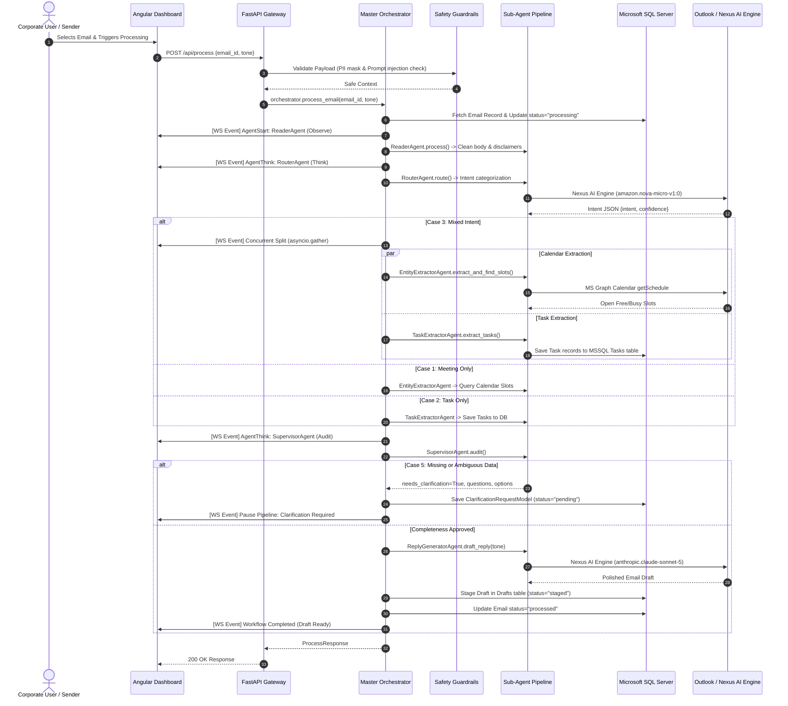

# Enterprise Email Agent Workspace - High-Level Design (HLD)

## 1. Executive Summary & System Overview

The **Enterprise Email Agent Workspace** is an enterprise-grade, multi-agent AI system developed to automate complex email workflows for corporate environments. Powered by **Nexus AI Engine** (with multi-model fallback orchestration) and backed by **Microsoft SQL Server (MSSQL)** and **Microsoft Graph (Outlook Mail & Calendar)**, the platform ingests incoming corporate emails, interprets user intent, extracts actionable entities, coordinates calendar schedules, logs structured tasks, and drafts context-aware responses with strict human-in-the-loop governance.

The system adopts a modular **Observe → Think → Act** multi-agent architecture with a real-time **WebSocket telemetry stream** (`/ws/stream`), enabling live visualization of agent reasoning steps on an **Angular 19** executive dashboard.

---

## 2. High-Level Architecture Diagram

```mermaid
flowchart TD
    subgraph ClientLayer ["Client Presentation Layer (Angular 19)"]
        UI["Executive Modern Workspace Dashboard"]
        InboxView["3-Column Inbox & AI Intelligence Hub"]
        TaskBoard["MSSQL Kanban Task Board"]
        CalendarView["Meeting Proposals & Stage 2 Coordination"]
        ClarificationView["Supervisor Clarification Deck"]
        TelemetryView["Live Agent Trace & Telemetry Stream"]
    end

    subgraph APILayer ["API & Gateway Layer (FastAPI Asynchronous Microservice)"]
        REST["REST API Endpoints (/api/emails, /api/process, /api/tasks, etc.)"]
        WSEndpoint["WebSocket Live Stream (/ws/stream)"]
        Guardrails["Enterprise Safety & Guardrail Shield (Injection & PII Redaction)"]
    end

    subgraph AgentOrchestration ["Multi-Agent Orchestration Engine"]
        Orchestrator["Master Multi-Agent Orchestrator (Observe -> Think -> Act)"]
        Reader["Reader Agent (Payload Normalization & Noise Cleaning)"]
        Router["Router / Planner Agent (Intent Classification)"]
        Extractor["Entity Extractor Agent (Calendar Finder)"]
        TaskAgent["Task Extractor Agent (To-Do List Creator)"]
        Supervisor["Supervisor Agent (Quality, Ambiguity & Clarification)"]
        Replier["Reply Generator Agent (Multi-Tone Smart Replier)"]
    end

    subgraph ExternalIntegrations ["Ecosystem & Infrastructure Connectors"]
        NexusLLM["Nexus AI Engine (Multi-Model Hierarchy)"]
        MSSQL[("Microsoft SQL Server (MSSQL) Persistence")]
        MSGraph["Microsoft Graph API (Outlook Mail & Calendar / MSAL)"]
        MockAdapters["Automated Mock Fallback Adapters"]
    end

    UI <-->|HTTP / REST| REST
    UI <-->|WebSocket Stream| WSEndpoint

    REST --> Guardrails
    Guardrails --> Orchestrator
    Orchestrator --> Reader
    Reader --> Router
    Router -->|Intent: Meeting| Extractor
    Router -->|Intent: Task| TaskAgent
    Router -->|Intent: Mixed Intent (Concurrent Gather)| Extractor
    Router -->|Intent: Mixed Intent (Concurrent Gather)| TaskAgent
    Extractor --> Supervisor
    TaskAgent --> Supervisor
    Supervisor -->|Ambiguous| ClarificationView
    Supervisor -->|Approved| Replier

    Orchestrator -.->|Live Telemetry Events| WSEndpoint
    Orchestrator <--> MSSQL
    Extractor <--> MSGraph
    Extractor -.-> MockAdapters
    Replier <--> NexusLLM
    Router <--> NexusLLM
    TaskAgent <--> NexusLLM
    Supervisor <--> NexusLLM
```

---

## 3. Core Business Use Cases & Flows

The workspace addresses five primary enterprise email automation scenarios:

| Case | Name | Primary Intent | Key Agents | Core Outcome |
| :--- | :--- | :--- | :--- | :--- |
| **Case 1** | The Calendar Finder | `meeting` | Reader, Router, Entity Extractor, Reply Generator | Parses date/time, checks Outlook free/busy slots, creates Staged Meeting Proposal (Stage 1), advances to Stage 2 on confirmation. |
| **Case 2** | The To-Do List Creator | `task` | Reader, Router, Task Extractor | Extracts actionable tasks (`title`, `owner`, `due_date`, `urgency`), persists records directly into MSSQL `Tasks` table. |
| **Case 3** | The Multi-Task Router | `mixed_intent` | Router, Entity Extractor, Task Extractor, Replier | Concurrently executes (`asyncio.gather`) meeting scheduling and task extraction without sequential latency. |
| **Case 4** | The Smart Replier | Any (`draft`) | Reply Generator | Synthesizes meeting slots and logged task confirmations into a contextual email draft with selectable corporate tones (`professional`, `friendly`, `concise`, `executive`). |
| **Case 5** | The Double-Checker | `ambiguous` | Supervisor Agent | Identifies missing or vague data (e.g., open-ended "sometime"), pauses pipeline, and presents 2-3 interactive options for human resolution. |

---

## 4. End-to-End Execution Sequence



---

## 5. Technology Stack & Component Allocation

| Layer | Technology | Version / Specification | Role in System |
| :--- | :--- | :--- | :--- |
| **Frontend Framework** | Angular | 19.2 (Standalone Components) | Responsive multi-column dashboard, real-time reactive event handling, state signals. |
| **Styling & UI** | Vanilla CSS + CSS Variables | Glassmorphism, HSL custom palette | Dark-themed, high-contrast, corporate aesthetic with micro-animations. |
| **Backend Framework** | FastAPI + Uvicorn | Python 3.11+ / ASGI | High-throughput asynchronous REST APIs and native WebSocket server. |
| **Relational Database** | Microsoft SQL Server (MSSQL) | SQL Server 2019/2022 + ODBC Driver 18 | ACID transactional storage for emails, tasks, proposals, drafts, and audit logs. |
| **ORM & Data Access** | SQLAlchemy + PyODBC | SQLAlchemy 2.0 | Declarative models, connection pooling, and transactional persistence. |
| **Generative AI Platform**| Nexus AI Engine | OpenAI-compatible REST + WS | Model orchestration (`amazon.nova-micro`, `anthropic.claude-sonnet-5`, `gpt-4o`). |
| **Ecosystem Connectors** | Microsoft Graph & MSAL | MSAL Python 1.28+ | Corporate Outlook Inbox and Calendar integration with mock fallback. |
| **Enterprise Security** | EnterpriseGuardrails Module | Regex + PII Redaction Engine | Prompt injection mitigation, credential leak protection, credit card & SSN masking. |

---

## 6. Non-Functional Requirements & Governance

1. **Enterprise Security & Compliance**:
   - Zero-trust prompt sanitization: Pre-execution regex inspection blocks privilege escalation (`ignore all instructions`, `system prompt override`).
   - PII Scrubbing: Automatically redacts SSNs, credit card numbers, and plaintext credentials before sending payloads to LLMs.
   - Output Sanitization: Scans generated text to prevent accidental API key leaks.
2. **Resilience & Fallback Hierarchy**:
   - Multi-model fallback: Primary model failure automatically cascades (`nova-micro` → `claude-sonnet-5` → `gpt-4o` → `llama3`).
   - Heuristic fallback: If the LLM service is entirely unreachable, built-in deterministic heuristic rule matchers parse intents and format fallback drafts.
   - Ecosystem fallback: When Azure AD credentials are omitted, the system transparently utilizes the built-in mock calendar and mail adapter.
3. **Observability & Auditability**:
   - Every agent step (`Observe`, `Think`, `Act`, `Error`) is measured with sub-millisecond precision (`AgentSpan`) and stored in the MSSQL `AgentLogs` table.
   - Real-time WebSocket telemetry enables operator auditability in production.
4. **Human-in-the-Loop Governance**:
   - No automated email is dispatched or calendar invite booked without affirmative human confirmation (Stage 1 user draft review before Stage 2 calendar confirmation, and draft approval before dispatch).
