# Enterprise Email Agent Workspace - Low-Level Design (LLD)

## 1. System Architecture & Module Structure

The backend is organized into cleanly decoupled layers: `agents/`, `adapters/`, `api/`, `core/`, `db/`, and `schemas/`.

```
backend/app/
├── adapters/            # External API clients (Nexus Engine, MS Graph, Mocks)
│   ├── base.py          # Abstract interfaces (BaseLLMClient, BaseEmailClient, BaseCalendarClient)
│   ├── nexus_client.py  # OpenAI-compatible client with multi-model fallback & WS
│   ├── outlook_calendar.py # MSAL Graph Calendar adapter with mock fallback
│   ├── outlook_mail.py     # MSAL Graph Mail adapter with mock fallback
│   └── mock_adapters.py    # Resilient mock implementations for offline development
├── agents/              # Autonomous agent implementations
│   ├── orchestrator.py  # Master controller (Observe -> Think -> Act) & WebSocket manager
│   ├── reader.py        # Ingestion, noise reduction, and disclaimer cleaning
│   ├── router.py        # Intent classification & heuristic fallback
│   ├── entity_extractor.py # Meeting entity extraction & free/busy slot queries
│   ├── task_extractor.py   # Action item parsing & direct MSSQL persistence
│   ├── supervisor.py       # Quality audit, ambiguity detection & clarification requests
│   └── reply_generator.py  # Multi-tone contextual draft generation & staging
├── api/                 # FastAPI routers & endpoints
│   ├── router.py        # Master API router aggregation
│   └── endpoints/       # Domain controllers (emails, process, tasks, meetings, actions)
├── core/                # System configuration, safety, and telemetry
│   ├── config.py        # Pydantic Settings (.env loader & DB URI builder)
│   ├── database.py      # SQLAlchemy engine, session maker, and DB initializer
│   ├── guardrails.py    # Prompt injection detection, PII masking & output scrubber
│   └── telemetry.py     # AgentSpan context manager & audit log persistence
├── db/                  # Relational persistence models
│   └── models.py        # SQLAlchemy ORM declarative models for MSSQL
└── schemas/             # Pydantic validation models (v2)
    ├── email.py         # Email ingestion & response schemas
    ├── meeting.py       # Meeting proposal schemas
    ├── response.py      # Process, Draft, and Clarification schemas
    └── task.py          # Task CRUD schemas
```

---

## 2. Agent Class Hierarchy & Method Specifications

```mermaid
classDiagram
    class MasterOrchestrator {
        +ConnectionManager ws_manager
        +process_email(email_id: int, db: Session, tone: str, stage: int) Dict
        -_emit_event(event_type: str, email_id: int, agent_name: str, step: str, details: Dict)
    }

    class ReaderAgent {
        +clean_email_body(raw_body: str) str
        +process(email_data: Dict) Dict
    }

    class RouterAgent {
        -str model
        +route(subject: str, body: str) Dict
    }

    class EntityExtractorAgent {
        -str model
        +extract_and_find_slots(subject: str, body: str, sender: str) Dict
    }

    class TaskExtractorAgent {
        -str model
        +extract_tasks(subject: str, body: str, sender: str) List~Dict~
        +save_tasks_to_db(tasks: List~Dict~, db: Session, email_id: int) List~TaskModel~
    }

    class SupervisorAgent {
        -str model
        +audit(subject: str, body: str, intent: str, meeting_data: Dict, tasks_data: List) Dict
        +record_clarification_in_db(clarification_data: Dict, db: Session, email_id: int) ClarificationRequestModel
    }

    class ReplyGeneratorAgent {
        -str model
        +draft_reply(subject: str, body: str, sender: str, recipient: str, intent: str, meeting_slots: List, tasks: List, tone: str) Dict
        -_generate_fallback_draft(...) Dict
        +save_draft_to_db(draft_dict: Dict, recipient: str, db: Session, email_id: int) DraftModel
    }

    MasterOrchestrator --> ReaderAgent : Step 1 Observe
    MasterOrchestrator --> RouterAgent : Step 2 Think
    MasterOrchestrator --> EntityExtractorAgent : Step 3 Act (Meeting / Mixed)
    MasterOrchestrator --> TaskExtractorAgent : Step 3 Act (Task / Mixed)
    MasterOrchestrator --> SupervisorAgent : Step 4 Audit (Case 5)
    MasterOrchestrator --> ReplyGeneratorAgent : Step 5 Draft (Case 4)
```



### Detailed Agent Signatures

#### 1. `ReaderAgent` (`app.agents.reader`)
- **`clean_email_body(raw_body: str) -> str`**:
  - Strips legal disclaimers matching regexes (`this message contains confidential information`, `sent from my iphone`, etc.).
  - Normalizes CRLF (`\r\n` -> `\n`) and collapses redundant newlines.
- **`process(email_data: Dict[str, Any]) -> Dict[str, Any]`**:
  - Normalizes sender display name from email address.
  - Returns context dictionary containing `cleaned_body`, `subject`, `sender`, `recipient`, and `word_count`.

#### 2. `RouterAgent` (`app.agents.router`)
- **`route(subject: str, body: str) -> Dict[str, Any]`**:
  - Invokes Nexus AI Engine using `MODEL_ROUTER` (`amazon.nova-micro-v1:0`) with `temperature=0.1` and `response_format={"type": "json_object"}`.
  - Returns: `{"intent": str, "confidence": float, "has_meeting_intent": bool, "has_task_intent": bool, "reasoning": str}`.
  - **Heuristic Fallback**: Evaluates keyword presence (`meet`, `sync`, `deck`, `budget`, `deadline`). If both are matched, classifies as `mixed_intent`.

#### 3. `EntityExtractorAgent` (`app.agents.entity_extractor`)
- **`extract_and_find_slots(subject: str, body: str, sender: str) -> Dict[str, Any]`**:
  - Extracts parameters: `requested_dates`, `preferred_time_range`, `duration_minutes`, `participants`, `topic`.
  - Integrates with `outlook_calendar_client.get_free_busy_slots(...)` to check availability.
  - Returns structured proposal payload with `stage=1` (Draft Review).

#### 4. `TaskExtractorAgent` (`app.agents.task_extractor`)
- **`extract_tasks(subject: str, body: str, sender: str) -> List[Dict[str, Any]]`**:
  - Extracts actionable items: `title`, `description`, `owner` (defaults to "Me"), `due_date`, and `urgency` (`low`, `medium`, `high`, `urgent`).
- **`save_tasks_to_db(tasks: List[Dict], db: Session, email_id: Optional[int]) -> List[TaskModel]`**:
  - Commits each extracted item into MSSQL `Tasks` table with default `status="pending"`.

#### 5. `SupervisorAgent` (`app.agents.supervisor`)
- **`audit(subject: str, body: str, intent: str, meeting_data: Dict, tasks_data: List) -> Dict[str, Any]`**:
  - Assesses ambiguity (e.g. open-ended words: "sometime", "whenever you are free", "handle that thing").
  - Returns `{needs_clarification: bool, missing_fields: List[str], question: str, options: List[str], reasoning: str}`.
- **`record_clarification_in_db(...) -> ClarificationRequestModel`**:
  - Persists pending clarification in MSSQL and transitions email status to `clarification_needed`.

#### 6. `ReplyGeneratorAgent` (`app.agents.reply_generator`)
- **`draft_reply(subject, body, sender, recipient, intent, meeting_slots, tasks, tone) -> Dict[str, str]`**:
  - Model: `MODEL_DRAFTING` (`anthropic.claude-sonnet-5`).
  - Synthesizes bulleted open slots and confirmed logged tasks into an email body matching the chosen tone (`professional`, `friendly`, `concise`, `executive`).
- **`save_draft_to_db(...) -> DraftModel`**:
  - Persists staged draft to MSSQL with `status="staged"`.

---

## 3. Database Schema & Entity-Relationship Design (MSSQL)

```mermaid
erDiagram
    Emails ||--o{ Tasks : "contains"
    Emails ||--o{ MeetingProposals : "generates"
    Emails ||--o{ Drafts : "produces"
    Emails ||--o{ AgentLogs : "traces"
    Emails ||--o{ ClarificationRequests : "triggers"

    Emails {
        int id PK "Identity(1,1)"
        varchar(100) thread_id "Nullable"
        varchar(255) subject "NOT NULL"
        varchar(255) sender "NOT NULL"
        varchar(255) recipient "NOT NULL"
        nvarchar(max) body "NOT NULL"
        datetime received_at "Default UTC"
        varchar(50) status "unread | processing | processed | clarification_needed | failed"
        varchar(50) intent "meeting | task | mixed_intent | general_inquiry | unknown"
        float confidence "Default 0.0"
        bit is_read "Default 0"
    }

    Tasks {
        int id PK "Identity(1,1)"
        int email_id FK "References Emails(id) ON DELETE CASCADE"
        varchar(255) title "NOT NULL"
        nvarchar(max) description "Nullable"
        varchar(255) owner "Default 'Me'"
        varchar(100) due_date "Nullable"
        varchar(50) urgency "low | medium | high | urgent"
        varchar(50) status "pending | in_progress | completed"
        datetime created_at "Default UTC"
        datetime updated_at "Default UTC"
    }

    MeetingProposals {
        int id PK "Identity(1,1)"
        int email_id FK "References Emails(id) ON DELETE CASCADE"
        varchar(500) requested_dates "Nullable"
        varchar(1000) participants "Nullable"
        nvarchar(max) proposed_slots_json "NOT NULL (JSON Array)"
        varchar(50) status "staged | confirmed | declined"
        int stage "1 = User Review, 2 = Auto Coordinated"
        datetime created_at "Default UTC"
    }

    Drafts {
        int id PK "Identity(1,1)"
        int email_id FK "References Emails(id) ON DELETE CASCADE"
        varchar(255) recipient "NOT NULL"
        varchar(255) subject "NOT NULL"
        nvarchar(max) body "NOT NULL"
        varchar(50) tone "professional | friendly | concise | executive"
        varchar(50) status "staged | approved | sent"
        datetime created_at "Default UTC"
        datetime approved_at "Nullable"
        datetime sent_at "Nullable"
    }

    AgentLogs {
        int id PK "Identity(1,1)"
        int email_id FK "References Emails(id) ON DELETE CASCADE"
        varchar(100) agent_name "NOT NULL"
        varchar(100) step "Observe | Think | Act | Error"
        varchar(255) action "NOT NULL"
        nvarchar(max) thought "Nullable"
        nvarchar(2000) input_data "Truncated JSON"
        nvarchar(2000) output_data "Truncated JSON"
        varchar(100) model_used "Nullable"
        float latency_ms "Execution time in ms"
        datetime created_at "Default UTC"
    }

    ClarificationRequests {
        int id PK "Identity(1,1)"
        int email_id FK "References Emails(id) ON DELETE CASCADE"
        varchar(500) missing_fields "NOT NULL"
        nvarchar(max) question "NOT NULL"
        nvarchar(max) options_json "NOT NULL (JSON Array)"
        varchar(50) status "pending | resolved"
        nvarchar(max) resolution "Nullable"
        datetime created_at "Default UTC"
    }
```



---

## 4. External Integrations & Adapters

### 4.1 Nexus Generative Engine Client (`app.adapters.nexus_client`)
- **Connection**: REST endpoint configured via `NEXUS_BASE_URL` and `NEXUS_API_KEY` (with backwards-compatible aliases).
- **Model Fallback Chain**:
  `[MODEL_ROUTER, MODEL_REASONING, MODEL_FALLBACK, "meta.llama3-8b-instruct-v1:0"]`
- **Embedded Guardrail Inspection**: All input messages pass through `EnterpriseGuardrails.inspect_input()` before transmission; outputs pass through `EnterpriseGuardrails.sanitize_output()`.
- **Streaming**: Native WebSocket endpoint `NEXUS_WS_URL` with fallback to REST chat completions.

### 4.2 Microsoft Graph & MSAL Adapters (`app.adapters`)
- **Authentication**: MSAL `ConfidentialClientApplication` acquiring bearer tokens for scope `https://graph.microsoft.com/.default`.
- **Calendar Client**: Calls `POST https://graph.microsoft.com/v1.0/me/calendar/getSchedule` to calculate free/busy availability; calls `POST https://graph.microsoft.com/v1.0/me/events` to confirm appointments.
- **Mail Client**: Calls `GET https://graph.microsoft.com/v1.0/me/mailFolders/inbox/messages` and `POST https://graph.microsoft.com/v1.0/me/sendMail`.
- **Mock Fallback**: If Azure AD credentials are omitted or API calls fail, the system delegates to `mock_calendar_client` and `mock_email_client` without disruption.

---

## 5. Enterprise Guardrails & Safety Architecture

Implemented in `app.core.guardrails.EnterpriseGuardrails`:
1. **Prompt Injection Inspection**:
   - Matches regex patterns including: `ignore (all) previous instructions`, `system prompt override`, `developer mode`, `jailbreak`, `drop table`, `<script>`.
   - Violations raise a `GuardrailViolation` exception, returning HTTP 400 with `violation_type: "INJECTION_ATTEMPT"`.
2. **PII Redaction**:
   - `\b(?:\d{4}[-\s]?){3}\d{4}\b` -> `[REDACTED_CREDIT_CARD]`
   - `\b\d{3}-\d{2}-\d{4}\b` -> `[REDACTED_SSN]`
   - `(?:password|secret)\s*[:=]\s*\S+` -> `password=[REDACTED_SECRET]`
3. **Output Sanitization**:
   - Regex scan for sensitive key patterns: `sk-[a-zA-Z0-9_\-]{16,}` -> `[REDACTED_API_KEY]`.

---

## 6. Real-time Telemetry & WebSocket Protocol

### 6.1 `AgentSpan` Context Manager (`app.core.telemetry`)
Instruments any code block using Python's `with AgentSpan(db, email_id, agent_name, step, action)`:
- Captures start time using `time.perf_counter()`.
- Records inputs and outputs safely formatted as JSON strings.
- Automatically captures exceptions and sets `step = "Error"`.
- Persists execution metrics to MSSQL `AgentLogs` table on block exit.

### 6.2 WebSocket Event Contract (`/ws/stream`)
The server broadcasts JSON payloads over `/ws/stream`:
```json
{
  "event_type": "agent_start" | "agent_think" | "agent_act" | "agent_finish",
  "email_id": 1,
  "agent_name": "RouterAgent",
  "step": "Think",
  "details": {
    "intent": "mixed_intent",
    "confidence": 0.95,
    "reasoning": "Meeting and deliverable identified"
  },
  "timestamp": "2026-09-23T10:45:00.123456"
}
```

---

## 7. REST API Endpoint Catalog

| Method | Endpoint | Description | Request Body | Response Model |
| :--- | :--- | :--- | :--- | :--- |
| `GET` | `/` | System health, MSSQL status, model mapping | None | `SystemStatus` |
| `GET` | `/api/emails` | List emails (supports `status`, `intent`, pagination) | None | `EmailListResponse` |
| `POST` | `/api/emails` | Ingest incoming email | `EmailCreate` | `EmailResponse` (201) |
| `GET` | `/api/emails/{id}` | Fetch email details by ID | None | `EmailResponse` |
| `PATCH`| `/api/emails/{id}/read` | Mark email as read | None | `EmailResponse` |
| `POST` | `/api/process` | Trigger multi-agent pipeline | `ProcessRequest` (`email_id`, `tone`) | `ProcessResponse` |
| `GET` | `/api/tasks` | List tasks (filter: `status`, `urgency`, `email_id`) | None | `TaskListResponse` |
| `POST` | `/api/tasks` | Create manual task | `TaskCreate` | `TaskResponse` (201) |
| `PUT` | `/api/tasks/{id}` | Update task status or urgency | `TaskUpdate` | `TaskResponse` |
| `DELETE`| `/api/tasks/{id}`| Delete task record | None | Status 204 |
| `GET` | `/api/scheduled-meetings` | List meeting proposals (filter: `stage`, `status`) | None | `MeetingProposalListResponse` |
| `POST` | `/api/scheduled-meetings/{id}/confirm` | Advance Stage 1 to Stage 2 calendar confirmation | None | `MeetingProposalResponse` |
| `GET` | `/api/drafts` | List generated drafts | None | `List[DraftResponse]` |
| `POST` | `/api/compose` | Compose manual draft | `DraftCreate` | `DraftResponse` (201) |
| `POST` | `/api/drafts/{id}/approve` | Approve staged draft | None | `DraftResponse` |
| `POST` | `/api/drafts/{id}/send` | Dispatch approved draft via Outlook | None | `DraftResponse` |
| `GET` | `/api/clarifications` | List clarification requests | None | `List[ClarificationResponse]` |
| `POST` | `/api/clarifications/{id}/reply` | Submit clarification resolution | `ClarificationReply` | `ClarificationResponse` |

---

## 8. Frontend Architecture & Component Decomposition (Angular 19)

### 8.1 State & Service Architecture
- **`ApiService`** (`core/services/api.service.ts`): Wraps all REST API calls using `HttpClient` returning RxJS `Observable` streams.
- **`WebSocketService`** (`core/services/websocket.service.ts`): Maintains resilient WebSocket connection to `/ws/stream` with automated exponential backoff reconnection.
- **`ToastService`** (`shared/components/toast/toast.service.ts`): Emits visual notification toasts for action confirmations, errors, and agent transitions.

### 8.2 Component Hierarchy
1. **`DashboardComponent`**: Top-level coordinator managing tabs (`inbox`, `tasks`, `meetings`, `clarifications`, `telemetry`), active email selection, and event distribution.
2. **`SidebarComponent`**: Navigation bar with real-time badges (unread emails, pending tasks, staged meetings, pending clarifications) and WebSocket connectivity indicator.
3. **`EmailListComponent`**: Chronological inbox deck with search, filtering, unread status indicators, and intent badges.
4. **`AiAnalysisComponent`**: The AI Intelligence Hub displaying:
   - 5-step interactive progress stepper (`Observe` → `Think` → `Act` → `Audit` → `Draft`).
   - Intent badge with model confidence percentage.
   - Stage 1 Meeting Proposals with open slot chips and "Confirm & Book" action.
   - Extracted task checklists with urgency badges.
   - Editable response draft with tone selector (`professional`, `friendly`, `concise`, `executive`) and "Approve" / "Send" buttons.
   - Interactive clarification questionnaire with clickable options for Case 5.
5. **`TaskBoardComponent`**: Full Kanban board grouping tasks into `Pending`, `In Progress`, and `Completed` with CRUD actions.
6. **`MeetingsComponent`**: Visual overview of all staged and confirmed calendar proposals.
7. **`TelemetryComponent`**: Real-time event log viewer displaying agent execution traces, timestamps, and model latency metrics.
8. **`ComposeModalComponent`**: Test modal allowing users to simulate incoming emails for testing Cases 1 through 5.
